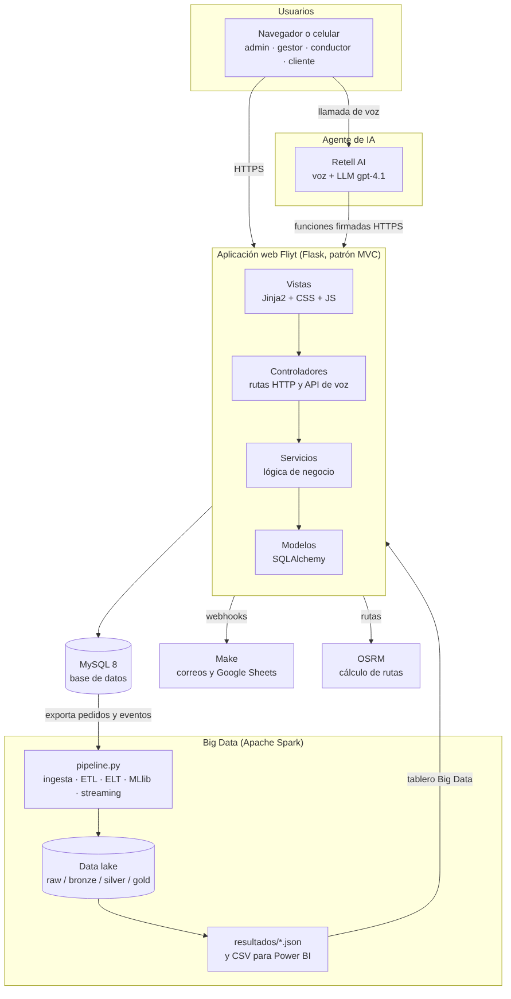

# Manual de usuario — Fliyt, Sistema de Gestión de Despachos

Versión 1.0 — 3 de noviembre de 2026

Equipo: Yorman Andrés Suárez Monroy, Juan Andrés Santoya Rojas. Ingeniería de Sistemas, Universidad de San Buenaventura.

## 1. Qué es Fliyt

Fliyt es una aplicación web para gestionar los despachos de última milla de un centro de distribución: registro de pedidos, planificación de rutas, entrega en terreno con el celular del conductor, control de inventario y seguimiento para el cliente. Incluye a Gaby, un asistente de voz con inteligencia artificial que permite hacer por voz lo mismo que en pantalla, según el rol de cada persona.

Dirección de la aplicación: https://rutalytics.yellowplant-1f14b776.eastus2.azurecontainerapps.io

Funciona en computador, tableta y celular, en cualquier navegador actualizado. En pantallas pequeñas el menú se abre con el botón «Menú».

## 2. Roles y qué puede hacer cada uno

| Rol | Para qué sirve | Pantallas principales |
| --- | --- | --- |
| Administrador | Configura el sistema, las cuentas y los permisos | Tablero, todas las de gestión, Administración (usuarios, contraseñas, roles, configuración, bitácora, errores, rendimiento) |
| Gestor logístico | Opera el día a día: pedidos, rutas e inventario | Tablero, Pedidos, Rutas, Inventario, Clientes, Analítica, Solicitudes, Vehículos |
| Conductor | Ejecuta la ruta del día y registra cada entrega | Mi ruta, Historial |
| Cliente | Consulta el estado de sus pedidos | Mis pedidos, Mis sedes |

Lo que cada persona ve en el menú depende de los permisos de su rol. El administrador puede ajustar esos permisos en Administración → Roles.

## 3. Primeros pasos (todos los roles)

### 3.1 Iniciar sesión

1. Abra la dirección de la aplicación.
2. Escriba su correo y su contraseña y pulse «Ingresar». Marque «Mantener sesión iniciada» solo en un equipo propio.
3. Si su cuenta es nueva o el administrador le asignó una contraseña temporal, el sistema le pedirá cambiarla.
Reglas de seguridad que conviene conocer:

- Tras 5 contraseñas equivocadas seguidas, la cuenta queda bloqueada 60 segundos.
- Si inicia sesión en otro navegador, la sesión anterior se cierra (sesión única).
- Después de un tiempo sin actividad, la sesión se cierra sola.
- La contraseña debe tener mínimo 8 caracteres, con mayúscula, minúscula, número y símbolo.

### 3.2 Olvidé mi contraseña

1. En la pantalla de inicio de sesión pulse «¿Olvidó su contraseña?».
2. Escriba su correo. Recibirá un enlace válido por 30 minutos y de un solo uso.
3. Abra el enlace y defina la contraseña nueva.

### 3.3 Mi perfil

Desde su nombre en la barra superior puede cambiar su contraseña, su correo de inicio de sesión y el «correo para avisos», que es donde le llegan las notificaciones de su rol.

### 3.4 Hablar con Gaby (asistente de voz)

1. Pulse el botón del micrófono, abajo a la derecha. El navegador le pedirá permiso para usar el micrófono.
2. Hable con normalidad, por ejemplo: «¿cuántos pedidos hay para hoy?» o «agrega diez unidades de arroz».
3. Antes de modificar cualquier dato, Gaby le lee un resumen y espera que usted confirme.
Gaby es una inteligencia artificial: puede entender mal una frase. Por eso confirma todo cambio antes de hacerlo, y cada acción queda registrada en la bitácora con origen «voz». Gaby solo puede hacer lo que su rol tiene permitido, y nunca dice contraseñas ni datos personales cifrados.

## 4. Gestor logístico

### 4.1 Tablero

Al entrar ve los indicadores del día (entregas a tiempo, tasa de fallos, pedidos en curso), el mapa de la ruta y las alertas de stock bajo. El botón «Enviar resumen del día» manda el resumen por correo a gestores y administradores.

### 4.2 Registrar pedidos

1. Pedidos → «Nuevo pedido».
2. Elija el cliente y su sede, agregue los productos con su cantidad, la fecha de despacho (no puede ser anterior a hoy), la prioridad y, si aplica, la ventana horaria.
3. Pulse guardar. El pedido queda «Pendiente».

### 4.3 Importar pedidos desde un archivo CSV

1. Pedidos → «Importar CSV». Puede descargar la plantilla desde esa misma pantalla.
2. Suba el archivo. El sistema muestra una vista previa con los pedidos válidos y los errores por fila.
3. Revise y confirme la importación.
Columnas obligatorias: cliente_nombre, direccion, sku, cantidad. Se rechaza un archivo que no sea un CSV real, un SKU que no existe o una fecha pasada. Hay un archivo de ejemplo en ejemplos/pedidos_prueba.csv.

### 4.4 Editar, anular y reprogramar pedidos

- Editar: en el detalle del pedido. Solo se editan los campos permitidos según su estado.
- Anular: escriba el motivo y pulse «Anular». Se puede anular un pedido pendiente, asignado o fallido.
- Reprogramar: un pedido fallido de un día anterior vuelve a «Pendiente» con una fecha nueva, para planificarlo en otra ruta.

### 4.5 Planificar una ruta

1. Rutas → «Planificar ruta».
2. Elija la fecha y pulse «Consultar» para ver los pedidos pendientes de ese día.
3. Seleccione el conductor, el vehículo, el criterio de orden (distancia o prioridad) y los pedidos. Pulse «Generar ruta».
4. El sistema calcula el orden de las paradas y la dibuja en el mapa. El conductor recibe un aviso por correo.
Reglas: un conductor y un vehículo solo pueden tener una ruta activa por día, y la carga no puede superar la capacidad en unidades del vehículo. En el detalle de la ruta puede «Recalcular ruta» o «Eliminar ruta» (sus pedidos vuelven a pendientes).

### 4.6 Inventario

- Inventario → «Nuevo producto» para crear un producto con su SKU, su stock inicial y su stock mínimo.
- En el detalle del producto, «Registrar movimiento»: «Entrada» (recepción de mercancía) o «Ajuste por inventario físico».
- El stock se descuenta solo cuando el conductor confirma la entrega. Si un producto baja del mínimo, aparece la alerta y los gestores reciben un correo.

### 4.7 Clientes, vehículos, solicitudes y analítica

- Clientes: crear clientes y sus sedes de entrega, y habilitar el portal para un cliente.
- Vehículos: placa, tipo, capacidad y conductor asignado.
- Solicitudes: mensajes de contacto que dejan los clientes.
- Analítica: indicadores históricos, rendimiento por conductor y motivos de fallo.

## 5. Conductor

1. Entre a «Mi ruta». Verá las paradas del día en orden.
2. Pulse «Iniciar ruta» para marcar todas las paradas como «En ruta». El cliente recibe un aviso.
3. Abra cada parada para ver la dirección, la mercancía y la ventana horaria. «Iniciar desplazamiento» abre la navegación en el mapa.
4. Al llegar: «Confirmar entrega», con el nombre y documento de quien recibe. El sistema guarda su ubicación como prueba de entrega y descuenta el inventario.
5. Si no se pudo entregar: «Registrar entrega fallida» y elija el motivo. Más tarde puede «Reintentar entrega».
En «Historial» quedan sus rutas anteriores. Todo esto también se puede hacer por voz con Gaby, útil mientras conduce.

## 6. Cliente

- «Mis pedidos»: estado de cada pedido (pendiente, asignado, en ruta, entregado, fallido o anulado).
- Al abrir un pedido ve el seguimiento paso a paso, los productos y, si ya se entregó, la constancia de entrega.
- «Mis sedes»: sus direcciones de entrega registradas.
- Recibe un correo cada vez que su pedido sale a ruta, se entrega o falla.
El cliente solo ve sus propios pedidos; nunca ve datos de otros clientes.

## 7. Administrador

- Usuarios: crear cuentas (con contraseña temporal enviada por correo), editar, activar o desactivar. Las cuentas no se borran: se desactivan, para conservar el historial.
- Contraseñas: generar una contraseña temporal o exigir el cambio a varias cuentas.
- Roles: crear roles y definir qué permisos tiene cada uno.
- Configuración: centro de distribución, motivos de fallo y tiempo de inactividad de la sesión.
- Bitácora: registro de cada acción (quién, cuándo, desde pantalla o voz).
- Errores y Rendimiento: errores del servidor y tiempos de respuesta por pantalla.
- Big Data: resultados del procesamiento con Apache Spark (demanda, fallos por zona, rendimiento, modelo de fallos).

## 8. Avisos por correo según el rol

| Evento | A quién le llega |
| --- | --- |
| Cambio de estado de un pedido (en ruta, entregado, fallido, anulado) | Al cliente del pedido |
| Stock bajo y solicitudes de contacto | A los gestores |
| Resumen diario (18:00 o con el botón del tablero) | A gestores y administradores |
| Ruta asignada o modificada | Al conductor de la ruta |
| Acciones hechas por voz | A los administradores |
| Contraseña temporal o enlace de recuperación | Al propio usuario |

## 9. Preguntas frecuentes

- No puedo entrar: verifique el correo, espere 60 segundos si se bloqueó, o use «¿Olvidó su contraseña?».
- Me sacó de la sesión: alguien inició sesión con su cuenta en otro navegador, o pasó el tiempo de inactividad.
- No me llegan los correos: revise el «correo para avisos» en su perfil y la carpeta de spam.
- Gaby no me escucha: dé permiso al micrófono en el navegador y use una conexión estable.
- No veo una opción del menú: su rol no tiene ese permiso; pídalo al administrador.

Anexo. Arquitectura general de la aplicación (docs/diagramas/01_arquitectura_general.png).

